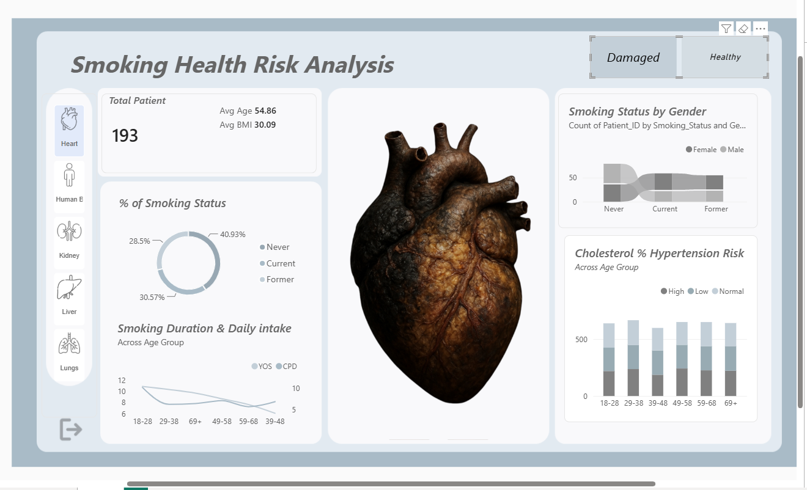

# Smoking Health Risk Analysis Dashboard

An interactive Power BI dashboard that explores how smoking behaviour relates to patient health indicators. The report includes organ views (Heart, Kidney, Liver, Lungs) and a **Damaged / Healthy** toggle.

## Project Overview
The dashboard summarises **193 patients** (average age **54.86**, average BMI **30.09**). It lets the viewer compare smoking status, smoking intensity and health risk factors across age groups and genders.

## Business Questions
- What share of patients are current, former or never smokers?
- How does smoking status differ between male and female patients?
- How do years of smoking (YOS) and cigarettes per day (CPD) vary across age groups?
- How do cholesterol and hypertension risk levels vary across age groups?

## Dashboard Features
| Visual | What it shows |
|---|---|
| Total Patient card | Patient count, average age and average BMI |
| % of Smoking Status | Never (40.93%), Current (30.57%), Former (28.5%) |
| Smoking Status by Gender | Patient counts by smoking status, split by Female / Male |
| Smoking Duration & Daily Intake | Average YOS and CPD across age groups |
| Cholesterol & Hypertension Risk | High / Normal / Low risk counts across age groups |
| Organ selector | Switches between Heart, Kidney, Liver, Lungs and Human Body views |
| Damaged / Healthy toggle | Changes the organ image and view |

## Tools Used
- **Power BI**: data modelling, measures, visuals, slicers and navigation design

## Key Insights
- Never-smokers are the largest group (40.93%), followed by current smokers (30.57%) and former smokers (28.5%). Almost 6 in 10 patients have smoked at some point.
- Cholesterol and hypertension risk appear in every age group, so the risk is not limited to older patients.
- The dashboard combines smoking duration and daily intake by age group, which makes it easy to compare smoking intensity across life stages.

## Repository Contents
- `health project.pbix`: the Power BI report
- `dashboard-preview.png`: screenshot of the dashboard
- The dataset used for the analysis

## How to Use
1. Download `health project.pbix`.
2. Open it in Power BI Desktop.
3. Use the organ buttons and the Damaged / Healthy toggle to explore the report.

## Author
**Victor Ezeanyim**
GitHub: [victor20489](https://github.com/victor20489)
